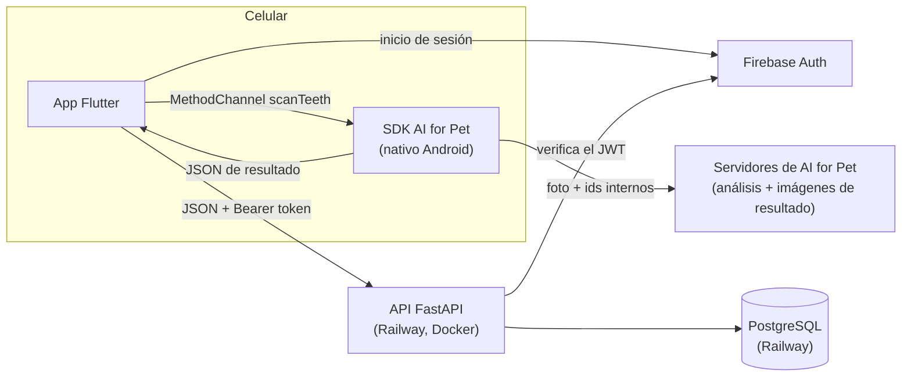
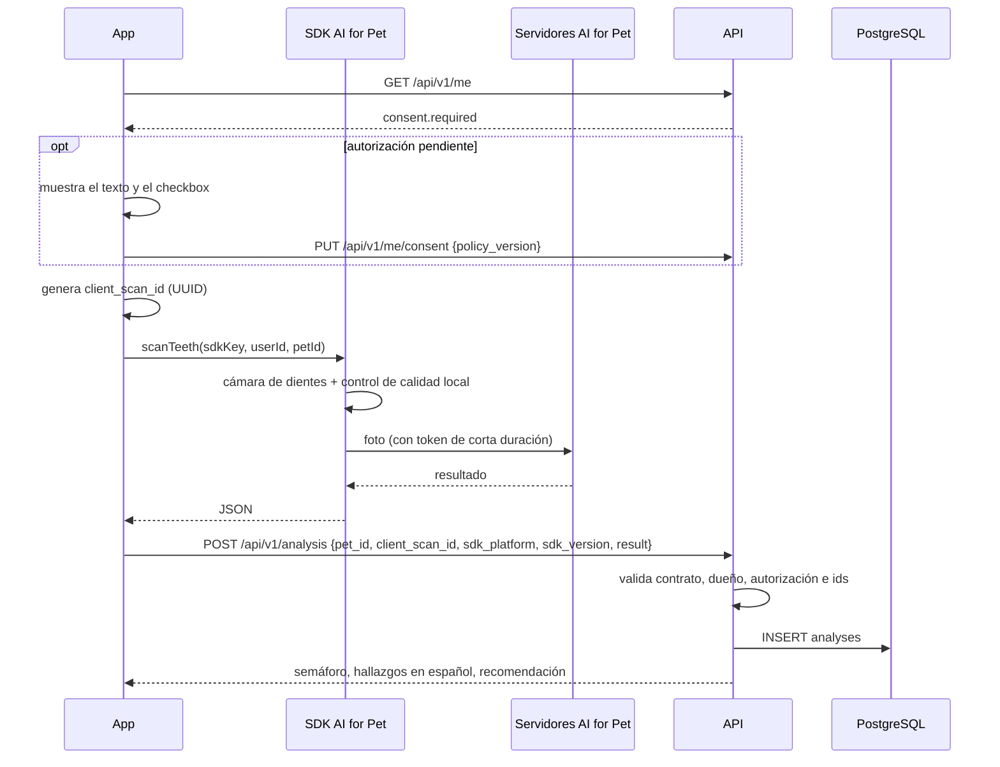

# Arquitectura de MandiDog IA

> **MandiDog IA no diagnostica.** Es una herramienta de tamizaje orientativo de salud
> dental en perros. Toda respuesta al usuario incluye la recomendación de consultar al
> veterinario, siempre visible y no ocultable.

## 0. Cambio de arquitectura (2026-11-04)

El plan inicial entrenaba un modelo propio (MobileNetV2/ResNet50) y subía las fotos a
Cloudflare R2. El equipo decidió **reemplazarlo por el SDK de AI for Pet** (TTcare): el
análisis de la foto lo hacen sus servidores. En consecuencia:

| Antes | Ahora |
|---|---|
| Modelo propio en `ml/` | SDK de AI for Pet; `ml/` sale del alcance |
| Foto → R2 con URL firmada → API → modelo | Foto → SDK → servidores de AI for Pet; la API solo recibe el resultado |
| Control de calidad propio (nitidez, luz) | Lo hace la cámara del SDK en el celular |
| Probabilidad + umbrales provisionales | Estado del proveedor (`NORMAL`/`CAUTION`/`WARNING`) |
| Autorización opcional para conservar la foto | Autorización **obligatoria** antes de usar la cámara (la foto sale del país) |

**Alcance:** el SDK detecta en dientes **sarro (`calculus`) e inflamación de encías
(`inflammation`)**. No detecta fracturas, tumores ni maloclusión, así que el alcance real es
salud dental y gingival, no "patologías mandibulares" en general. El título y los objetivos
del proyecto deben ajustarse con el director.

## 1. Componentes



| Pieza | Tecnología | Carpeta |
|---|---|---|
| App | Flutter (Dart), Android 9+ | `app/` |
| Análisis | SDK de AI for Pet `io.github.aiforpet-ttcare:scansdk-lib:2.2.3` | `app/android/` |
| API | FastAPI + Uvicorn, Python 3.11, Docker | `api/` |
| Base de datos | PostgreSQL gestionado en Railway, migraciones con Alembic | `api/alembic/` |
| Autenticación | Firebase Auth (modo `dev` solo local) | — |

## 2. Flujo de un escaneo



Si el envío a la API falla (sin señal), la app **reintenta con el mismo `client_scan_id`**:
la API devuelve el análisis ya guardado (200) en lugar de duplicarlo, y no se consume otro
análisis del plan de AI for Pet.

## 3. Integración con el SDK

| Aspecto | Valor |
|---|---|
| Dependencia | `io.github.aiforpet-ttcare:scansdk-lib:2.2.3` (Maven Central). Es la versión que documenta la consola; existe una 3.1.0 sin guía publicada |
| Android mínimo | 9.0 (`minSdk 28`) |
| Pantalla nativa | `com.aiforpet.pet.check.ToothCameraActivity` |
| Canal Flutter | `co.edu.ucc.mandidog/aiforpet`, método `scanTeeth` (`MainActivity.kt`) |
| Datos enviados | `petType=DOG`, `userId` y `petId` (UUID de nuestra API), `sdkKey`. Nunca nombre, correo ni raza |
| Opciones | sin cuestionario (no está en español), sin pantalla de resultado del SDK, sin PDF, una sola foto |
| Clave | publicable (`tt_pk_test_…` / `tt_pk_live_…`), se pasa al compilar con `--dart-define=AIFORPET_SDK_KEY=…` y no se sube a git |
| Identidad de la app | paquete `co.edu.ucc.mandidog` + SHA-256 del certificado de firma, registrados en la consola de AI for Pet. Debug, release y Google Play App Signing tienen huellas distintas: hay que registrar cada una |
| ProGuard/R8 | el `.aar` trae sus propias reglas; no hay que agregar nada |

El SDK cambia la clave publicable por un token de corta duración en el *Token Broker* de AI
for Pet y con ese token envía la foto. La interfaz del SDK está en coreano, inglés,
japonés, italiano, sueco o tailandés; **no tiene español**.

## 4. Interpretación del resultado

`api/app/services/aiforpet.py` aplica el contrato documentado por AI for Pet:

| Del SDK | En MandiDog |
|---|---|
| raíz `status = SUCCESS` | solo significa que el análisis terminó; no que todo esté normal |
| `response.status = NORMAL` | **verde** |
| `response.status = CAUTION` | **amarillo** (se recomienda observar) |
| `response.status = WARNING` | **rojo** (se recomienda consulta) |
| `symptoms[].code` | identidad del hallazgo; nunca se usa la posición en la lista |
| `abnormalLevel` (si viene) o `abnormLevel` | 0 → normal · positivo → anormal · negativo → no evaluado |
| `calculus` / `inflammation` | "Sarro (cálculo dental)" / "Inflamación de encías" |
| código desconocido | se muestra el nombre del SDK o el código |

- **No hay porcentaje de confianza.** AI for Pet no expone puntajes ni probabilidades del
  modelo; la app muestra el semáforo y la lista de hallazgos.
- El JSON original se guarda completo en `analyses.provider_result` (auditoría y validación
  clínica). Campos nuevos que agregue AI for Pet se aceptan sin romper la API.
- La recomendación está en español y **siempre** termina con: *"Este resultado es
  orientativo y no es un diagnóstico: consulta siempre a tu veterinario."*

### Qué verifica la API al recibir un resultado

1. La autorización de datos vigente del usuario (409 `consent_required`).
2. Que la mascota sea del usuario (404 `pet_not_found`).
3. Que el JSON sea un escaneo dental de perro terminado (`SUCCESS`, `DOG`, `TOOTH`, estado
   conocido, máximo 64 KB) (422 `scan_result_invalid`).
4. Que `userId` y `petId` del resultado sean los del usuario y la mascota (422
   `scan_result_mismatch`).
5. Que el `client_scan_id` no se haya usado con otros datos (409 `scan_id_conflict`).

**Limitación conocida:** la API no puede comprobar criptográficamente que el JSON lo generó
AI for Pet; lo reporta la app. La consola de AI for Pet ofrece un *Webhook URL* para recibir
resultados directamente de sus servidores; es la mejora natural cuando se publique su
formato. La base de datos además exige que el semáforo corresponda al estado del proveedor
(`ck_analyses_risk_matches_status`).

## 5. Autorización de datos (Ley 1581)

Detalle en [datos-y-consentimiento.md](datos-y-consentimiento.md). Resumen:

- Sin autorización vigente la app **no abre la cámara**: en cuanto se toma la foto, el SDK
  la envía a AI for Pet (transferencia internacional).
- La autorización se registra por usuario (`users.consent_policy_version`, `consent_at`) y
  cada análisis guarda la versión que estaba vigente.
- Si el texto cambia, sube `CONSENT_POLICY_VERSION` y todos deben aceptarlo de nuevo.

## 6. Autenticación

| `AUTH_MODE` | Cómo identifica al usuario |
|---|---|
| `firebase` | `Authorization: Bearer <ID token>`. Se verifica con PyJWT contra las llaves públicas de Google (RS256, `aud`, `iss`, `exp`, `auth_time`). Solo requiere `FIREBASE_PROJECT_ID`. |
| `dev` | Header `X-Dev-User: <id>`, sin verificación; el uid se guarda como `dev:<id>`. Advertencia visible en los logs y **la API no arranca así con `ENV=production`**. |

## 7. Endpoints

| Método | Ruta | Descripción |
|---|---|---|
| GET | `/health` | Estado, versión y proveedor de análisis (503 si la BD no responde) |
| GET | `/api/v1/me` | Usuario (se crea en la primera llamada) y estado de su autorización |
| PUT | `/api/v1/me/consent` | Aceptar la versión vigente del texto de autorización |
| DELETE | `/api/v1/me/consent` | Revocar la autorización (bloquea análisis nuevos) |
| DELETE | `/api/v1/me` | Eliminar la cuenta con mascotas e historial |
| POST / GET | `/api/v1/pets` | Crear / listar mis mascotas |
| GET / PATCH / DELETE | `/api/v1/pets/{id}` | Ver / editar / borrar (con su historial) |
| GET | `/api/v1/pets/{id}/analyses` | Historial, del más reciente al más antiguo (`limit`, `offset`) |
| POST | `/api/v1/analysis` | Registrar el resultado de un escaneo (201, o 200 si es un reintento) |

Especificación completa en `/docs` (OpenAPI).

### Errores

```json
{"error": {"code": "scan_result_invalid", "message": "El resultado del escaneo no tiene…",
           "details": [{"field": "part", "problem": "Input should be 'TOOTH'"}]}}
```

| HTTP | `code` | Qué hacer en la app |
|---|---|---|
| 401 | `missing_credentials`, `invalid_token` | Volver a iniciar sesión |
| 404 | `pet_not_found` | Refrescar la lista de mascotas |
| 409 | `consent_required`, `consent_policy_outdated` | Mostrar el texto de autorización vigente |
| 409 | `scan_id_conflict` | Repetir el escaneo con un `client_scan_id` nuevo |
| 409 | `account_has_validations` | Contactar al equipo |
| 422 | `scan_result_invalid`, `scan_result_mismatch` | Repetir el escaneo; reportar si se repite |
| 503 | `auth_unavailable` | Servicio caído: reintentar más tarde |
| red | sin respuesta | Reintentar `POST /analysis` con el **mismo** `client_scan_id` |

## 8. Modelo de datos

Migraciones: `0001_esquema_inicial` (diseño original) y `0002_integracion_aiforpet` (cambio
de arquitectura). IDs UUID y fechas `timestamptz`.

| Tabla | Propósito |
|---|---|
| `users` | Cuenta (`firebase_uid` único, `role` owner/vet/admin) y autorización de datos |
| `pets` | Mascotas del propietario (CASCADE al borrar el usuario) |
| `analyses` | `client_scan_id` único, semáforo, estado del proveedor, posición (`TLEFT`/`TCENTER`/`TRIGHT`), hallazgos (JSONB), JSON original (JSONB), versión del SDK, recomendación y versión de la autorización |
| `validations` | Validación clínica ciega por veterinarios (`sin_signos`, `con_signos`, `no_evaluable`); los endpoints llegan después |

Índice `ix_analyses_pet_created (pet_id, created_at DESC)` para el historial.

## 9. Despliegue (pendiente de configurar)

- **API en Railway** con el `Dockerfile` de `api/` (última etapa `prod`, usuario sin root).
  `docker/start.sh` aplica las migraciones y arranca Uvicorn en `$PORT`. La `DATABASE_URL`
  de Railway se normaliza sola al driver `psycopg`.
- **AI for Pet en producción:** requiere aprobación explícita de AI for Pet para la
  organización, claves `tt_pk_live_` y el SHA-256 de la llave de publicación (y el de Google
  Play App Signing si se usa). La clave de prueba vence el 2026-11-18.
- **Dominio propio con SSL:** pendiente.

## 10. Decisiones registradas

| Decisión | Motivo |
|---|---|
| SDK de AI for Pet en lugar de modelo propio | Decisión del equipo (2026-11-04) |
| Sin almacenamiento propio de fotos (se retiró R2/MinIO) | El SDK no entrega la foto original, solo enlaces a recortes en sus servidores |
| Una foto por escaneo, sin cuestionario | Flujo estándar del SDK; el cuestionario no está en español |
| SDK Android fijado en 2.2.3 | Es la versión documentada para las claves publicables actuales |
| `client_scan_id` idempotente | Reintentar un envío fallido no duplica análisis ni consume otro del plan |
| Migración 0002 en lugar de reescribir la 0001 | La 0001 ya estaba aplicada; queda registro del cambio |
| PyJWT en vez de `firebase-admin` | `firebase-admin` exige una cuenta de servicio fuera de Google Cloud |
| Tests contra PostgreSQL real | Los CHECK, enums y JSONB son de Postgres |
| Sin YOLO/Ultralytics | AGPL-3.0 (decisión original, se mantiene) |
