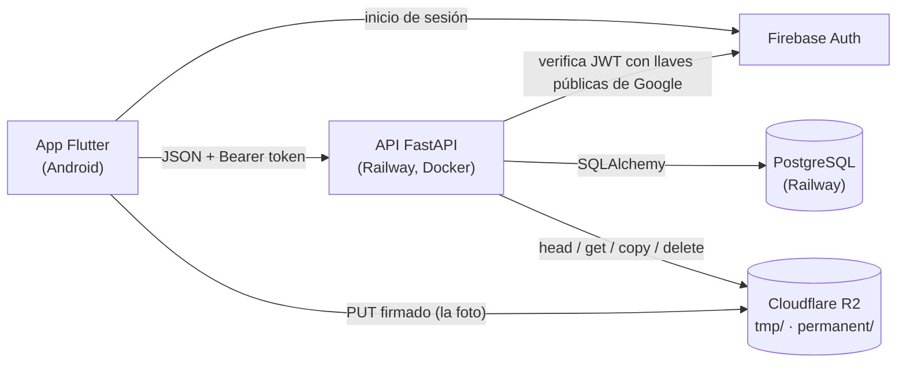
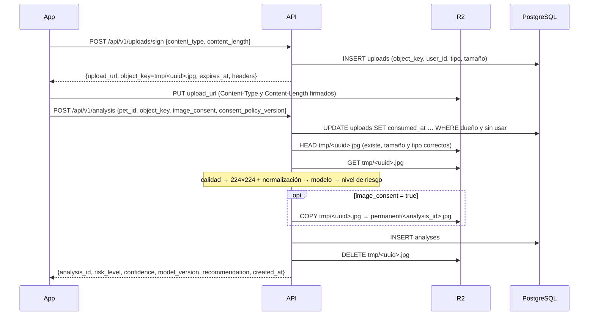

# Arquitectura de MandiDog IA

> **MandiDog IA no diagnostica.** Es una herramienta de tamizaje orientativo. Toda
> respuesta al usuario incluye la recomendación de consultar al veterinario.

## 1. Componentes



| Pieza | Tecnología | Notas |
|---|---|---|
| App | Flutter (Dart), Android primero | Etapa 3 |
| API | FastAPI + Uvicorn, Python 3.11, Docker | `api/` |
| Modelo | TensorFlow/Keras, transfer learning MobileNetV2 / ResNet50 | `ml/` (etapa 2) |
| Base de datos | PostgreSQL gestionado en Railway | migraciones con Alembic |
| Imágenes | Cloudflare R2 vía boto3 (API S3) | MinIO en local |
| Autenticación | Firebase Auth | modo `dev` solo local |

## 2. Flujo de análisis: carga por URL firmada

La foto **no pasa por la API**. La app la sube directo a R2 con una URL firmada; la API
solo la descarga cuando hay que procesarla. Así el contenedor no carga con el tráfico de
imágenes y la respuesta es más rápida (objetivo: menos de 10 s de punta a punta).



### 2.1 Límite de tipo y tamaño en la firma

La URL firmada es un **PUT** con vigencia de 5 minutos. Un PUT firmado no admite un rango
de tamaño (`content-length-range` solo existe en el POST firmado con *policy*), y
**Cloudflare R2 no soporta POST firmado**. Por eso la app declara el tipo y el tamaño
**exactos** al pedir la firma, y ambos quedan como cabeceras firmadas
(`X-Amz-SignedHeaders=content-length;content-type;host`). Si la app sube otro tipo u otro
tamaño, R2 rechaza la firma con 403. La API valida antes de firmar que el tipo sea
`image/jpeg` o `image/png` y que el tamaño no supere 10 MB.

### 2.2 Verificación de pertenencia de la `object_key`

La clave la genera el servidor (`tmp/<uuid4>.<ext>`) y queda registrada en la tabla
`uploads` a nombre del usuario. Al procesar:

1. **Formato.** Se exige `^tmp/<uuid>\.(jpg|png)$`. Claves como `permanent/…` o `../`
   se rechazan con 422.
2. **Reclamo atómico**, en la misma transacción que crea el análisis:
   ```sql
   UPDATE uploads SET consumed_at = now()
   WHERE object_key = :key AND user_id = :usuario AND consumed_at IS NULL
   RETURNING *;
   ```
   - Sin filas → **404 `upload_not_found`**, el mismo error si la clave no existe o es de
     otro usuario, para no revelar claves ajenas.
   - Clave propia ya usada → **409 `upload_already_used`**. Cada carga se procesa una vez.
   - Error inesperado (R2 caído, fallo del modelo) → rollback; la carga se puede reintentar.
   - Rechazo por calidad o por objeto que no coincide → se confirma el consumo y se borra
     el temporal.
3. **Mascota.** El `pet_id` debe pertenecer al usuario (404 `pet_not_found`).
4. **`head_object` antes de descargar.** El objeto debe existir y su tamaño y tipo deben
   coincidir con lo registrado al firmar.
5. **Formato real.** Tras descargar, Pillow revisa los bytes del archivo; no se confía en
   la cabecera `Content-Type`.

## 3. Consentimiento (Ley 1581 de 2012)

Resumen; el detalle está en [datos-y-consentimiento.md](datos-y-consentimiento.md).

- La URL firmada apunta **siempre** a `tmp/`. La API borra el temporal apenas termina de
  procesarlo, haya o no consentimiento y también si lo rechaza por calidad.
- Con `image_consent=true` la API copia el objeto a `permanent/<analysis_id>.<ext>` y
  guarda esa ruta en `image_key`, junto con `consent_at` y `consent_policy_version`.
- Una regla de ciclo de vida borra `tmp/` al día siguiente: es la red de seguridad para
  las fotos subidas que nunca se procesan.
- La base de datos impide guardar una imagen sin consentimiento aunque la API tenga un bug:
  `CHECK (image_key IS NULL OR (image_consent AND consent_at IS NOT NULL))`, más los CHECK
  de política completa, prefijo `permanent/` y revocación sin imagen.

## 4. Nivel de riesgo

El modelo es un clasificador **binario** (`sin_signos` / `con_signos`) que devuelve
`p = P(con_signos)`. La API lo traduce a tres niveles:

| Condición | Nivel |
|---|---|
| `p < RISK_THRESHOLD_YELLOW` | verde |
| `RISK_THRESHOLD_YELLOW ≤ p < RISK_THRESHOLD_RED` | amarillo |
| `p ≥ RISK_THRESHOLD_RED` | rojo |

- `probability_signs = p`
- `confidence = max(p, 1 − p)`: la probabilidad que el modelo asigna a la clase que predice.

> [!IMPORTANT]
> **`RISK_THRESHOLD_YELLOW=0.30` y `RISK_THRESHOLD_RED=0.60` son PROVISIONALES.**
> Son bajos a propósito: en tamizaje se prefiere un falso positivo (una consulta de más)
> a un falso negativo (un caso que no se revisa). El valor definitivo sale del **barrido
> del umbral de decisión en la validación cruzada estratificada de 5 particiones de `ml/`**:
> `RISK_THRESHOLD_YELLOW` será el umbral que alcance la **sensibilidad objetivo**, medida
> sobre las predicciones fuera de partición con particiones agrupadas por perro. El
> criterio exacto de `RISK_THRESHOLD_RED` se fija con el mismo barrido en la etapa 2.
> Los umbrales se cambian solo por variable de entorno, sin tocar código.

Todas las recomendaciones terminan con el aviso: *"Este resultado es orientativo y no es
un diagnóstico: consulta siempre a tu veterinario."*

## 5. Control de calidad de la foto

Antes de inferir (`api/app/services/image_quality.py`):

| Control | Regla | Variable |
|---|---|---|
| Formato | JPEG (incluye MPO de algunos celulares) o PNG, coincidente con lo firmado | — |
| Píxeles | máximo 40 MP (evita bombas de descompresión) | — |
| Tamaño | lado menor ≥ 224 px | `QUALITY_MIN_SIDE_PX` |
| Desenfoque | varianza del laplaciano, con el lado mayor reducido a 512 px | `QUALITY_MIN_BLUR_VARIANCE` |
| Luz | luminancia media entre los límites | `QUALITY_MIN_LUMINANCE`, `QUALITY_MAX_LUMINANCE` |

Si falla, la API responde **422 `image_quality`** con la lista de problemas y un mensaje que
dice qué corregir. La orientación EXIF del celular se aplica antes de medir y de inferir.
Los límites de desenfoque y luz también son provisionales: se ajustarán con fotos reales.

## 6. Inferencia intercambiable

`api/app/inference/` define el contrato `InferenceBackend` (`version`, `preprocessing`,
`predict`). La implementación se elige con `INFERENCE_BACKEND`:

- `stub`: devuelve una probabilidad fija (`INFERENCE_STUB_PROBABILITY`). Permite trabajar en
  `api/` y `app/` mientras `ml/` entrena. **La API no arranca con `stub` y `ENV=production`**:
  daría resultados falsos a usuarios reales.
- `keras`: carga el `.keras` de `INFERENCE_MODEL_PATH` y el `.json` de metadatos que genera
  `ml/` (versión, tamaño de entrada y normalización: `mobilenet_v2` o `resnet50`).

El preprocesamiento redimensiona directo a 224×224 sin recortar, igual que el entrenamiento.

## 7. Autenticación

| `AUTH_MODE` | Cómo identifica al usuario |
|---|---|
| `firebase` | `Authorization: Bearer <ID token>`. Se verifica con PyJWT contra las llaves públicas de Google (firma RS256, `aud`, `iss`, `exp`, `auth_time`). Solo requiere `FIREBASE_PROJECT_ID`, sin cuenta de servicio. |
| `dev` | Header `X-Dev-User: <id>`, sin verificación. El uid se guarda como `dev:<id>`. |

Con `AUTH_MODE=dev` la API escribe una advertencia visible en los logs al arrancar, y
**se niega a arrancar si `ENV=production`**. El usuario se crea en la primera petición
autenticada (`GET /api/v1/me`).

## 8. Endpoints

| Método | Ruta | Descripción |
|---|---|---|
| GET | `/health` | Estado del servicio, versión y modelo cargado (503 si la BD no responde) |
| GET | `/api/v1/me` | Usuario autenticado (lo crea en la primera llamada) |
| POST | `/api/v1/pets` | Crear mascota |
| GET | `/api/v1/pets` | Listar mis mascotas |
| GET / PATCH / DELETE | `/api/v1/pets/{id}` | Ver / editar / borrar (borra también historial y fotos) |
| GET | `/api/v1/pets/{id}/analyses` | Historial, del más reciente al más antiguo (`limit`, `offset`) |
| POST | `/api/v1/uploads/sign` | URL firmada para subir la foto |
| POST | `/api/v1/analysis` | Procesar la foto subida |
| DELETE | `/api/v1/analyses/{id}/image` | Revocar la autorización: borra la foto |

La especificación completa queda en `/docs` (OpenAPI).

### Formato de errores

```json
{"error": {"code": "image_quality", "message": "La foto no tiene la calidad suficiente…",
           "details": [{"code": "blurry", "message": "La foto está desenfocada. …"}]}}
```

`message` está en español y se puede mostrar tal cual. Códigos que la app debe manejar:

| HTTP | `code` | Qué hacer en la app |
|---|---|---|
| 401 | `missing_credentials`, `invalid_token` | Volver a iniciar sesión |
| 404 | `upload_missing` | Reintentar el PUT (si la URL venció, pedir otra firma) |
| 404 | `upload_not_found`, `pet_not_found` | Volver a empezar la captura |
| 409 | `upload_already_used` | Tomar una foto nueva |
| 409 | `consent_policy_outdated` | Actualizar la app / mostrar el texto vigente |
| 422 | `image_quality` | Mostrar `details[].message` y volver a la cámara |
| 422 | `upload_mismatch`, `file_too_large`, `validation_error` | Tomar la foto de nuevo |
| 503 | `storage_unavailable`, `auth_unavailable` | Servicio caído: reintentar más tarde |

## 9. Modelo de datos

Esquema canónico: `api/alembic/versions/0001_esquema_inicial.py`. IDs UUID y fechas
`timestamptz`.

| Tabla | Propósito |
|---|---|
| `users` | Cuenta (`firebase_uid` único, `role`: owner / vet / admin) |
| `pets` | Mascotas del propietario (CASCADE al borrar el usuario) |
| `uploads` | Cada URL firmada entregada: base de la verificación de pertenencia |
| `analyses` | Resultado, métricas de calidad, versión del modelo y consentimiento |
| `validations` | Validación clínica ciega por veterinarios (`sin_signos`, `con_signos`, `no_evaluable`); los endpoints llegan después |

Índice `ix_analyses_pet_created (pet_id, created_at DESC)` para el historial.

## 10. Despliegue (pendiente de configurar)

- **API en Railway** con el `Dockerfile` de `api/` (última etapa: `prod`, usuario sin root).
  `docker/start.sh` aplica las migraciones y arranca Uvicorn en `$PORT`. La `DATABASE_URL`
  de Railway (`postgresql://…`) se normaliza sola al driver `psycopg`.
- **R2:** `S3_ENDPOINT_URL=https://<ACCOUNT_ID>.r2.cloudflarestorage.com`, `S3_REGION=auto`,
  y `S3_PUBLIC_ENDPOINT_URL` igual al endpoint. El bucket y la regla de `tmp/` se crean con
  `python -m scripts.init_storage` (el mismo script que usa docker-compose con MinIO).
- **Dominio propio con SSL:** pendiente.

## 11. Decisiones registradas

| Decisión | Motivo |
|---|---|
| Clasificación de imagen completa, sin YOLO/Ultralytics | AGPL-3.0 obligaría a liberar el código; además la tarea no es detección de objetos |
| Tabla `uploads` para la pertenencia, no el uid en la ruta | Permite uso único y trazabilidad; la ruta queda `tmp/<uuid>` |
| Tamaño y tipo exactos firmados en el PUT | R2 no soporta POST firmado con rango de tamaño |
| PyJWT en vez de `firebase-admin` | `firebase-admin` exige una cuenta de servicio fuera de Google Cloud; PyJWT solo necesita el id del proyecto |
| MinIO de Chainguard, fijado por digest | MinIO dejó de publicar imágenes oficiales en Docker Hub y quay.io |
| Tests contra Postgres y MinIO reales | Los CHECK y enums son de Postgres; la firma solo se prueba contra un servidor S3 |
| `uv` + `uv.lock` | Builds reproducibles y Python 3.11 aislado del Python del sistema |
