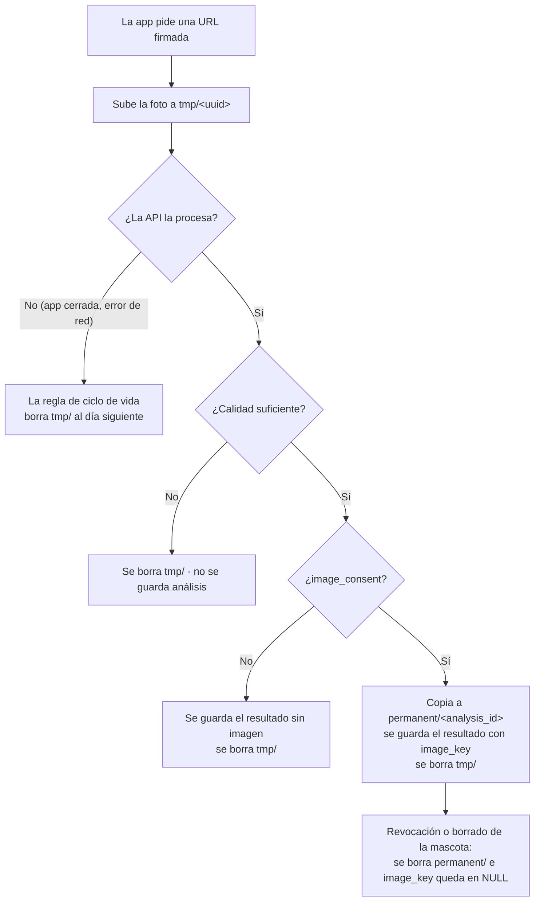

# Datos y consentimiento

Cómo MandiDog IA trata los datos personales y las fotos, en el marco de la **Ley 1581 de
2012** (protección de datos personales) y su decreto reglamentario **1377 de 2013**
(compilado en el Decreto 1074 de 2015).

> Este documento describe las garantías técnicas del sistema. El texto legal definitivo
> de la autorización y de la política de tratamiento debe revisarlo el director del
> proyecto o la oficina jurídica de la UCC antes de publicar la app.

## 1. Qué datos se tratan

La foto es de la boca de un perro, pero se trata como dato personal: está asociada a la
cuenta del propietario y puede mostrar sus manos, su casa u otros elementos que lo
identifiquen.

| Dato | Dónde se guarda | Para qué | Cuánto tiempo |
|---|---|---|---|
| Correo y nombre visible | PostgreSQL (`users`), vienen de Firebase | Identificar la cuenta | Mientras exista la cuenta |
| Datos de la mascota (nombre, raza, sexo, nacimiento, peso) | PostgreSQL (`pets`) | Historial y contexto del análisis | Hasta que el propietario borre la mascota |
| Resultado del análisis y métricas de calidad | PostgreSQL (`analyses`) | Historial del propietario y evaluación del modelo | Hasta que se borre la mascota |
| Foto **sin** autorización | R2, `tmp/<uuid>` | Solo para analizarla | Se borra al terminar el análisis (ver §3) |
| Foto **con** autorización | R2, `permanent/<analysis_id>` | Investigación: entrenar y validar el modelo | Hasta que el propietario revoque la autorización o borre la mascota |
| Registro de cargas firmadas | PostgreSQL (`uploads`) | Verificar a quién pertenece cada foto subida | Mientras exista la cuenta (no contiene imágenes) |

## 2. Autorización previa, expresa e informada

- La app muestra un **checkbox explícito**, sin marcar por defecto, con el texto de
  autorización (§6) antes de enviar la foto.
- Si el propietario no marca la casilla, el análisis se hace igual: la autorización es
  **voluntaria** y no condiciona el servicio.
- Con la casilla marcada, la app envía `image_consent=true` y la versión del texto que
  mostró (`consent_policy_version`). La API la compara con `CONSENT_POLICY_VERSION`; si no
  coincide responde 409 y no guarda nada. Así queda constancia de **qué texto aceptó**.
- Se registran `consent_at` (fecha y hora) y `consent_policy_version` en el análisis.

## 3. Ciclo de vida de una foto

- **El temporal nunca se conserva.** La API borra `tmp/<uuid>` al terminar de procesarlo,
  en todos los casos: con o sin consentimiento y también si lo rechaza por calidad.
- **Cargas abandonadas.** Si la foto se sube pero nunca se procesa, la borra la regla de
  ciclo de vida del bucket (`tmp/`, 1 día). Las reglas trabajan en días y R2 ejecuta el
  borrado *normalmente dentro de las 24 h siguientes* al vencimiento, así que una foto
  abandonada puede permanecer **hasta ~48 h**. No es "24 h exactas".
- Si el borrado inmediato del temporal falla (R2 no responde), la regla de ciclo de vida
  lo borra de todas formas, en el mismo plazo.

## 4. Garantías en la base de datos

Aunque la API tenga un bug, PostgreSQL rechaza estos estados en `analyses`:

| Restricción | Qué impide |
|---|---|
| `ck_analyses_image_key_requires_consent` | Guardar una imagen sin `image_consent` y `consent_at` |
| `ck_analyses_consent_complete` | Marcar consentimiento sin fecha o sin versión del texto |
| `ck_analyses_image_key_permanent` | Que `image_key` apunte fuera de `permanent/` (por ejemplo a `tmp/`) |
| `ck_analyses_revoked_has_no_image` | Que un consentimiento revocado conserve la imagen |

Las cuatro tienen pruebas automáticas (`api/tests/test_consent.py`) que insertan filas
inválidas directamente con SQL y verifican el rechazo.

## 5. Derechos del titular

| Derecho (Ley 1581, art. 8) | Cómo se ejerce |
|---|---|
| Conocer sus datos | `GET /api/v1/me`, `GET /api/v1/pets`, historial de cada mascota |
| Actualizar y rectificar | `PATCH /api/v1/pets/{id}` |
| Revocar la autorización | `DELETE /api/v1/analyses/{id}/image`: borra la foto de R2, deja `image_key` en NULL y registra `consent_revoked_at` |
| Suprimir | `DELETE /api/v1/pets/{id}`: borra la mascota, su historial y sus fotos (primero en R2, después en la BD) |

**Pendiente:** endpoint para eliminar la cuenta completa (`DELETE /api/v1/me`), que borre
todas las mascotas y fotos y luego el usuario.

## 6. Texto de autorización (borrador)

Versión: **`2026-11-v1`** (debe coincidir con `CONSENT_POLICY_VERSION`). Si el texto
cambia, se crea una versión nueva y se actualizan juntas la app y la variable de entorno.

> **Autorización para uso investigativo de la foto**
>
> Autorizo a MandiDog IA, proyecto de grado del programa de Ingeniería de Software de la
> Universidad Cooperativa de Colombia, sede Pasto, a conservar la foto que envío en este
> análisis y a usarla con fines de investigación académica: entrenar y evaluar el modelo
> de inteligencia artificial, incluida su revisión por médicos veterinarios.
>
> Entiendo que:
> 1. Esta autorización es voluntaria. Si no la doy, el análisis se hace igual y la foto se
>    elimina al terminar.
> 2. La foto se guarda con un identificador interno, separada de mi correo y mi nombre.
> 3. Puedo revocar esta autorización en cualquier momento desde el historial de mi mascota,
>    y la foto se eliminará.
> 4. El resultado de MandiDog IA es orientativo, no es un diagnóstico y no reemplaza la
>    consulta con un veterinario.
>
> Responsable del tratamiento: *[nombre, correo de contacto y dirección del responsable]*.

## 7. Dataset de entrenamiento (`ml/`)

Las fotos con las que se entrena el modelo **no** vienen de la app en esta etapa: vienen de
un dataset etiquetado aparte (~120 imágenes, 2–3 ángulos por perro). Ese dataset:

- no se versiona en git (`ml/data/` está en `.gitignore`);
- requiere su propia autorización de los propietarios o de la clínica que aporta las fotos;
- se describe con un CSV de metadatos (`filename, class, dog_id, breed, age_months,
  cephalic_type`) **sin datos del propietario**.

Cuando se incorporen fotos con autorización recogidas por la app, solo podrán usarse las
de análisis con `image_key` no nulo, es decir, con consentimiento vigente.
