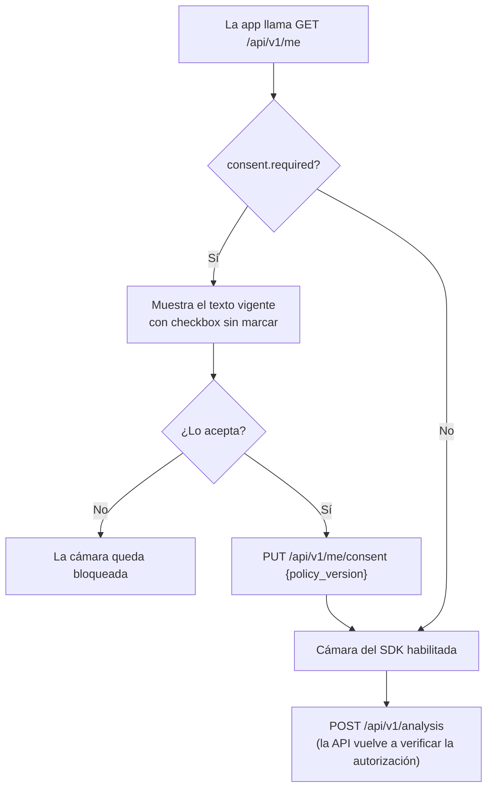

# Datos y consentimiento

Cómo MandiDog IA trata los datos personales en el marco de la **Ley 1581 de 2012**
(protección de datos personales) y su decreto reglamentario **1377 de 2013** (compilado en
el Decreto 1074 de 2015).

> Este documento describe el diseño técnico. El texto legal definitivo de la autorización y
> de la política de tratamiento debe revisarlo el director del proyecto o la oficina
> jurídica de la UCC antes de publicar la app.

## 1. Quién trata qué datos

El análisis lo hace **AI for Pet** (TTcare) en sus servidores. MandiDog no recibe ni guarda
la foto.

| Dato | Lo recibe / guarda | Para qué | Cuánto tiempo |
|---|---|---|---|
| Foto de los dientes del perro | **AI for Pet** (la envía su SDK desde el celular) | Analizarla | **Desconocido: pendiente de confirmar con AI for Pet** |
| Recortes y mapas de calor del análisis | **AI for Pet** (`cdn-results.ai4pet.com`) | Mostrar el resultado | **Desconocido: pendiente** |
| Id interno del usuario y de la mascota (UUID) | AI for Pet y MandiDog | Relacionar el resultado | — |
| Correo y nombre visible | MandiDog (`users`), vienen de Firebase | Identificar la cuenta | Mientras exista la cuenta |
| Datos de la mascota (nombre, raza, sexo, nacimiento, peso) | MandiDog (`pets`) | Historial | Hasta que se borre la mascota o la cuenta |
| Resultado (semáforo, hallazgos, JSON del SDK con enlaces a los recortes) | MandiDog (`analyses`) | Historial y evaluación académica | Hasta que se borre la mascota o la cuenta |
| Autorización aceptada (versión y fecha) | MandiDog (`users`, `analyses`) | Probar que hubo autorización | Mientras exista la cuenta |

**Minimización:** al SDK solo se le pasan identificadores internos (UUID). AI for Pet no
recibe el nombre, el correo, la raza ni la fecha de nacimiento.

La foto se trata como dato personal: está ligada a la cuenta del propietario y puede mostrar
sus manos, su casa u otros elementos que lo identifiquen.

## 2. Transferencia internacional (art. 26)

AI for Pet es una empresa de Corea del Sur. Enviarle la foto es una **transferencia
internacional de datos**. El artículo 26 la permite, entre otros casos, cuando el titular da
su **autorización expresa e inequívoca** para la transferencia. Por eso:

- La autorización es **obligatoria** para usar la cámara: sin ella la app no abre el SDK.
- El texto nombra a AI for Pet, el país y la finalidad (§5).
- Queda constancia de la versión del texto y la fecha de aceptación.

La UCC debe confirmar si además corresponde algún trámite ante la Superintendencia de
Industria y Comercio.

## 3. Cómo se registra la autorización

- `users.consent_policy_version` y `users.consent_at` guardan qué versión aceptó y cuándo.
  La BD exige que vayan juntos (`ck_users_consent_complete`).
- La API rechaza aceptar una versión distinta de `CONSENT_POLICY_VERSION` (409
  `consent_policy_outdated`) y rechaza registrar análisis sin la autorización vigente (409
  `consent_required`).
- Cada análisis guarda la versión vigente al registrarse (`analyses.consent_policy_version`,
  no puede ir vacía).
- Si el texto cambia, se sube la versión en la app y en la variable de entorno, y todos los
  usuarios deben aceptarlo de nuevo antes de escanear.

**Importante para la app:** la verificación de la API ocurre *después* de que la foto llegó a
AI for Pet. La garantía real es que la app no abra la cámara mientras `consent.required` sea
`true`. Esa regla se prueba en la etapa 3.

## 4. Derechos del titular (art. 8)

| Derecho | Cómo se ejerce en MandiDog |
|---|---|
| Conocer sus datos | `GET /api/v1/me`, `GET /api/v1/pets`, historial de cada mascota |
| Actualizar y rectificar | `PATCH /api/v1/pets/{id}` |
| Revocar la autorización | `DELETE /api/v1/me/consent`: bloquea escaneos nuevos; el historial se conserva |
| Suprimir | `DELETE /api/v1/pets/{id}` (mascota e historial) o `DELETE /api/v1/me` (toda la cuenta) |

**Limitación:** borrar datos en MandiDog **no borra lo que guarda AI for Pet** (fotos,
recortes, resultados). Hay que acordar con AI for Pet el procedimiento de supresión y
explicarlo en la política de tratamiento.

## 5. Texto de autorización (borrador)

Versión: **`2026-11-v2`** (debe coincidir con `CONSENT_POLICY_VERSION`). La versión
`2026-11-v1` correspondía al diseño anterior (fotos guardadas en almacenamiento propio) y
ya no aplica.

> **Autorización de tratamiento de datos**
>
> Para analizar la salud dental de mi perro, autorizo a MandiDog IA, proyecto de grado del
> programa de Ingeniería de Software de la Universidad Cooperativa de Colombia, sede Pasto, a:
>
> 1. **Enviar las fotos de los dientes de mi perro a AI for Pet**, empresa de Corea del Sur
>    que hace el análisis con inteligencia artificial en sus servidores. Junto con la foto
>    solo se envía un identificador interno, no mi nombre ni mi correo.
> 2. Guardar en MandiDog el resultado de cada análisis para mostrarme el historial.
> 3. Usar los resultados, sin datos que me identifiquen, en la investigación académica del
>    proyecto.
>
> Entiendo que:
> - Sin esta autorización no puedo usar la cámara de análisis.
> - Puedo revocarla en cualquier momento desde mi perfil y borrar mis mascotas o mi cuenta.
>   Los datos que conserve AI for Pet se eliminan según su propio procedimiento.
> - El resultado es orientativo, no es un diagnóstico y no reemplaza la consulta con un
>   veterinario.
>
> Responsable del tratamiento: *[nombre, correo de contacto y dirección del responsable]*.
> Encargado: AI for Pet Inc. *[datos de contacto]*.

Puntos para revisar con el director:
- Si el uso académico de los resultados (punto 3) debe ser opcional, con un checkbox aparte.
- Los datos del responsable y del encargado del tratamiento.

## 6. Pendiente con AI for Pet

Escribir a aiforpet@aiforpet.com para obtener por escrito:

1. **Cuánto tiempo conservan** las fotos, los recortes y los resultados, y en qué país se
   procesan.
2. **Procedimiento de supresión** cuando un usuario lo pida.
3. Si ofrecen un **acuerdo de tratamiento de datos** (encargado del tratamiento).
4. **Aprobación para producción** (claves `tt_pk_live_`) y extensión del periodo de prueba
   si hace falta (vence el 2026-11-18).

## 7. Garantías en la base de datos

| Restricción | Qué impide |
|---|---|
| `ck_users_consent_complete` | Versión de autorización sin fecha, o fecha sin versión |
| `ck_analyses_consent_policy_version` | Registrar un análisis sin la versión de autorización |
| `ck_analyses_risk_matches_status` | Que el semáforo no corresponda al estado que devolvió AI for Pet |
| `ck_analyses_part`, `ck_analyses_sub_part` | Guardar resultados que no sean de dientes |

Todas tienen pruebas automáticas (`api/tests/test_consent.py`) que insertan filas inválidas
directamente con SQL y verifican el rechazo.
